# replive 存消息、图和视频工具

> **重要通知 📢📢📢**
>
> 为应对中日关系恶化，本文将发起对日本 app replive 的制裁，严肃开源 replive 存图和视频、录制直播的工具并提供教程。

代码：[huangwg2529/nsy_chat_live](https://github.com/huangwg2529/nsy_chat_live)。

下载：[GitHub Releases](https://github.com/huangwg2529/nsy_chat_live/releases)。

本文对应的 [PDF 版本](replive存消息、图和视频工具.pdf) 也保存在本目录。

## 1. 功能说明

### 登录

对于 Windows 电脑、使用谷歌账号或 X 账号登录的 replive，不再需要抓包。首次打开时会跳转到浏览器，根据浏览器提示操作登录和授权即可。

X 账号登录好像会过期，过期后也会跳转到网页重新登录授权。如果一直报错 `401`，可以手动删除 `config.yaml` 中 `refresh_token:` 后面的内容，再重新打开登录。X 登录未使用第二个账号测试，可能还有未知问题。

其他账号或 mac 用户仍需自行抓包。建议使用 workbuddy、codex、opencode 等 AI 工具协助处理。

### 消息和媒体存储

保存 fandom chat 里的图片和视频，按下图的文件夹结构存储。

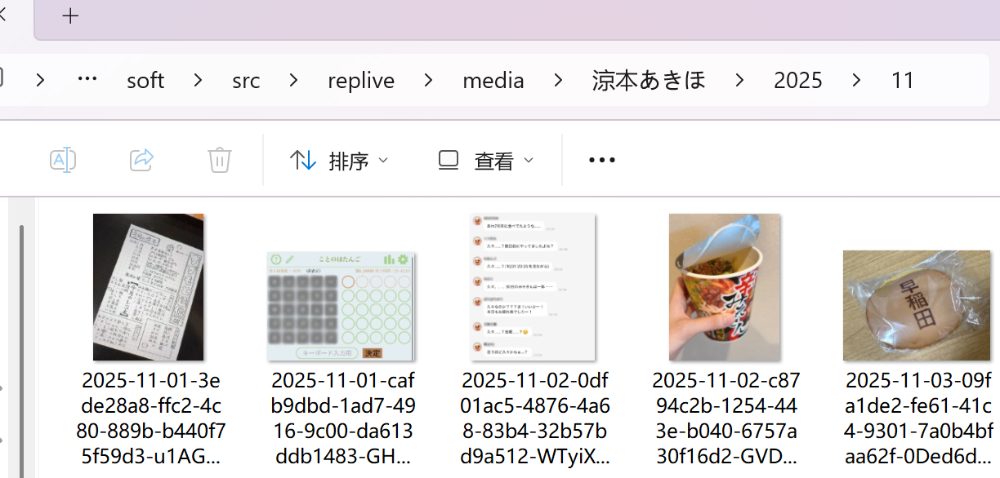

同时保存关注声优的背景图和头像等。

所有消息、图片和小视频会在本地存储，并提供一个网页，可以按日期跳转和关键词搜索。点击搜索结果可以跳转到当时的上下文。

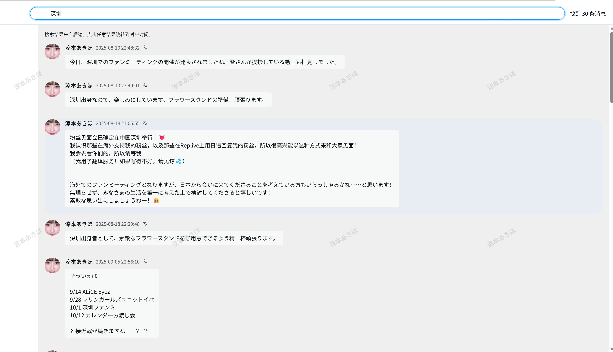

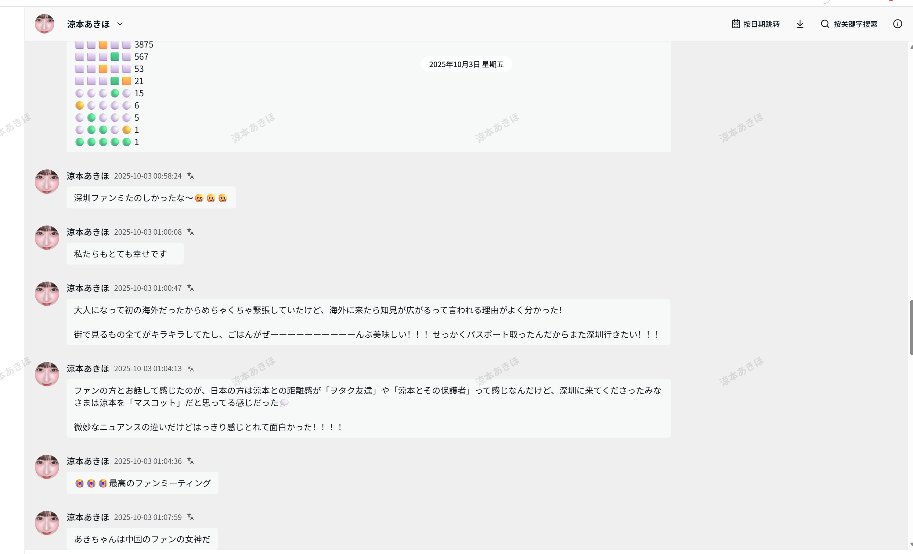

### 直播录制

可以录制直播，需要安装好 ffmpeg。

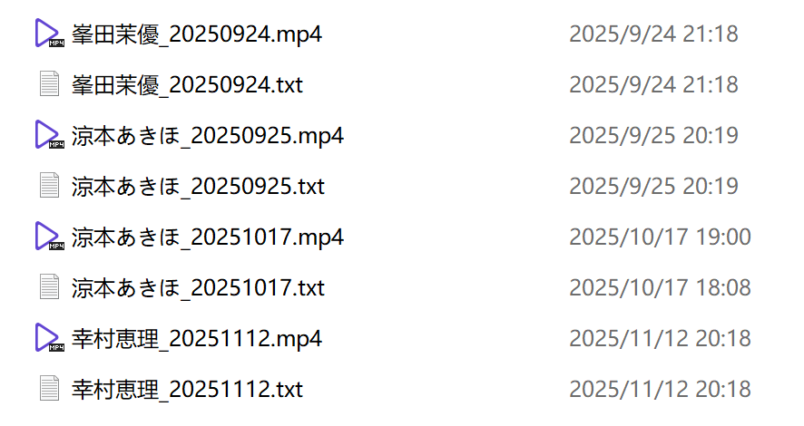

### 邮件接收

图片和短视频可以配置邮件接收。一般用本地下载功能就够了；邮件功能主要用于上班时公司 VPN 与科学上网冲突的场景。

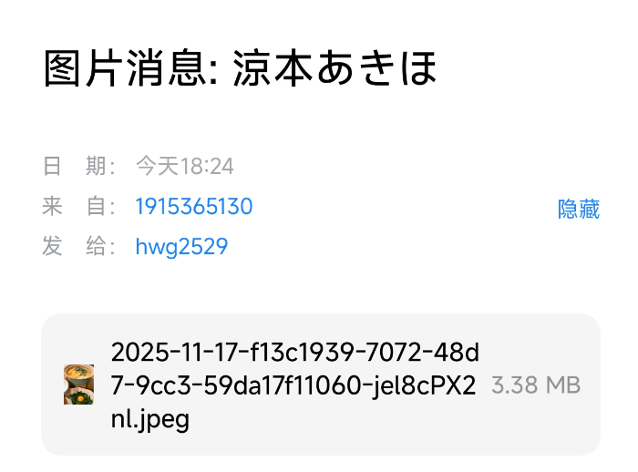

## 2. 使用方式

### 2.1 下载程序

下载 [v1.2 发布文件](https://github.com/huangwg2529/nsy_chat_live/releases/tag/v1.2)。

- Windows 用户下载两个 exe 和 `config.yaml`。
- Linux 和 mac 用户按需下载，对应程序仍有待测试。程序在 Windows 环境打包，编译脚本由 AI 编写，不保证这两个系统能正常使用；也可以下载源码，配置 Go 环境后自行编译。

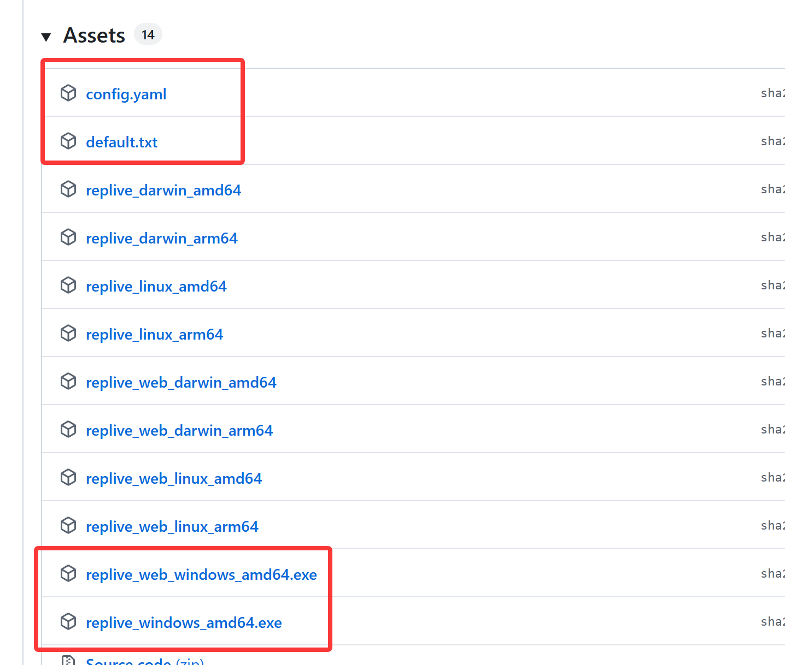

### 2.2 配置代理

用记事本打开 `config.yaml`，保证代理端口号正确。

如果所在环境不需要代理，就把 `host` 和 `port` 后面的内容清空，不再强制走代理。

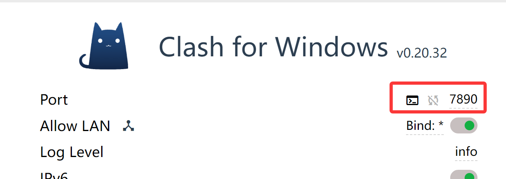

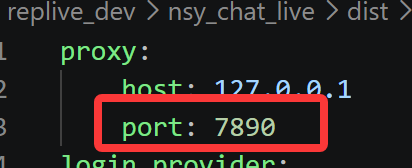

> v2ray 可能会有问题，原文作者使用 Clash 没有问题，其他配置请自行验证。

### 2.3 继承旧数据

如果以前使用过旧版本，已有 `media` 文件夹和 `sqlite.db` 文件，将它们与新程序放在同一个文件夹即可继承旧数据。

### 2.4 登录并同步消息

打开 `replive_windows_amd64.exe` 登录，操作与网页谷歌登录类似。

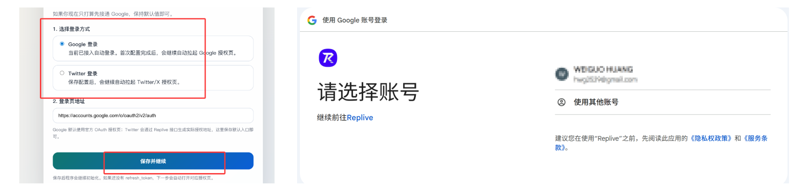

等待程序加载历史消息、下载历史图片和视频。完成后会自动监听新消息和图片；每次重新打开，也会继续拉取关闭期间产生的消息和图片。

### 2.5 使用网页

历史消息拉取完成后（一般一分钟内），打开 `replive_web_xx.exe`，程序会自动打开网页。左上角切换声优，右上角搜索。

下面是抓包教程，可以直接登录的用户不需要阅读。

## 3. 抓包

### 3.1 获取 replive 登录 token

准备抓包软件。iOS 好像可以直接抓包，安卓需要 root；手机没有 root 时，可以使用 PC 安卓模拟器。下面以 MuMu 模拟器和 Charles 为例。

请参考 [MuMu 模拟器抓包教程](https://mumu.163.com/help/20240814/40912_1174291.html#1.%E4%BD%BF%E7%94%A8%E6%9C%80%E6%96%B0%E7%89%88%E6%9C%ACMuMu%E6%A8%A1%E6%8B%9F%E5%99%A8)。

#### 3.1.1 安装 MuMu 模拟器、Charles 和 replive

自行下载 MuMu 模拟器和 Charles，上面的教程也有下载方式。MuMu 模拟器有 Go 安装器，安装好 Play 商店后，安装 replive 并登录。

#### 3.1.2 配置代理和证书

大部分步骤按上述教程操作即可，下面补充图文说明。

需要执行 `openssl x509 -inform PEM -subject_hash_old -in charles.pem`。如果电脑没有 OpenSSL，或不熟悉环境变量配置，可以按以下步骤操作。

先从 [OpenSSL 下载页](https://slproweb.com/products/Win32OpenSSL.html) 下载并指定路径安装。安装后进入对应目录的 `bin` 文件夹，把证书文件复制到这里。复制文件资源管理器地址栏中的路径，例如 `C:\Program Files\OpenSSL-Win64\bin`。

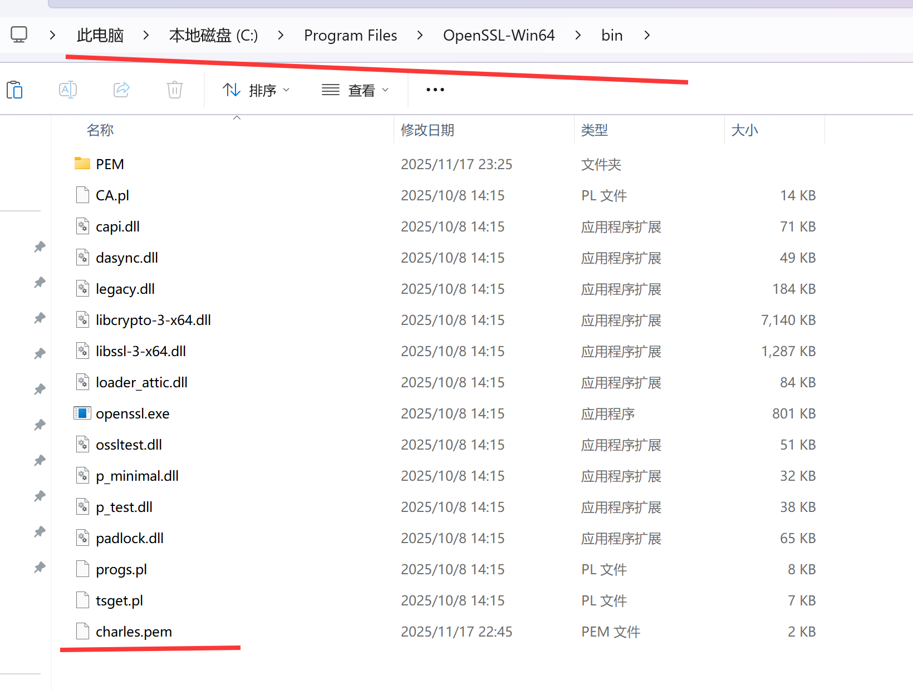

按 `Win + R`，输入 `cmd` 打开命令提示符。先切换到上述路径，再执行命令获取结果：

```bat
cd /d "C:\Program Files\OpenSSL-Win64\bin"
.\openssl.exe x509 -inform PEM -subject_hash_old -in charles.pem
```

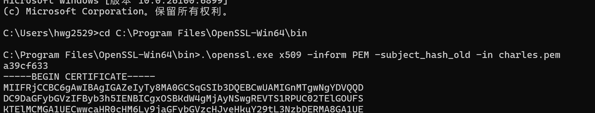

如果按教程导入证书不成功，可以采用以下方式。找到 MuMu 模拟器安装目录，例如 `C:\Program Files\Netease\MuMu\nx_main`，把上面生成的 `xxx.0` 证书文件复制到这里。

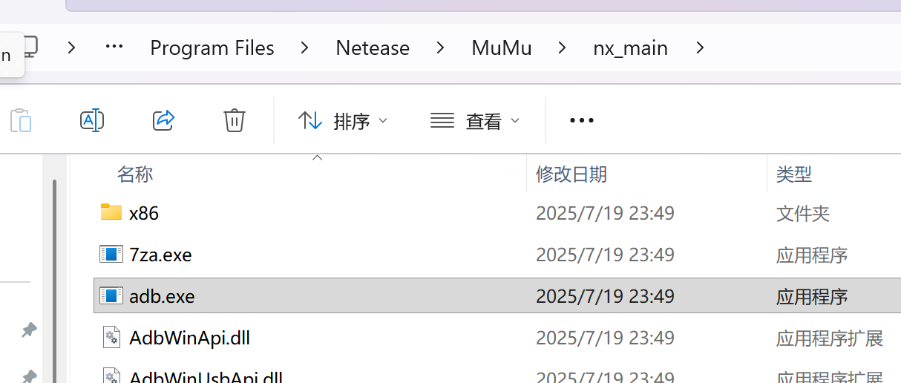

打开 cmd，逐行执行下面的命令。将目录替换为实际 MuMu 安装目录，将 `a39cf633.0` 替换为自己的证书文件名：

```bat
cd /d "C:\Program Files\Netease\MuMu\nx_main"
.\adb.exe kill-server
.\adb.exe connect 127.0.0.1:7555
.\adb.exe -s 127.0.0.1:7555 root
.\adb.exe connect 127.0.0.1:7555
.\adb.exe -s 127.0.0.1:7555 push a39cf633.0 /system/etc/security/cacerts
.\adb.exe -s 127.0.0.1:7555 shell "chmod 664 /system/etc/security/cacerts/a39cf633.0"
```

#### 3.1.3 为 Charles 配置二级代理

在 Charles 菜单栏选择 `Proxy → External Proxy Settings`，按下图勾选并填写。Clash 默认配置可参考下图，其他代理请按实际情况配置。

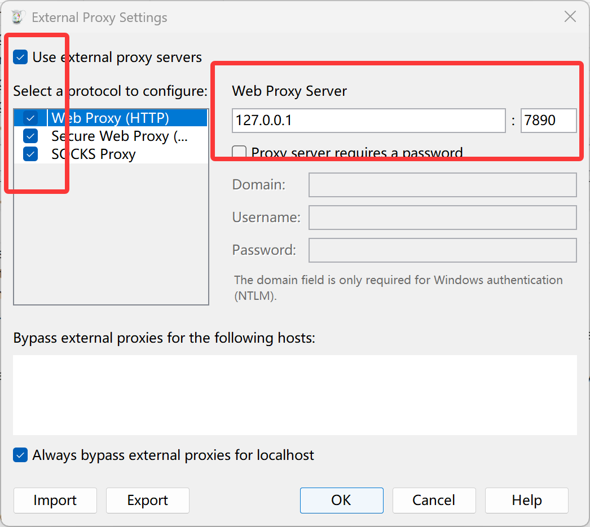

#### 3.1.4 获取 refresh token

开启 Charles，正常使用 replive，Charles 就会显示抓到的请求和图片。

在 Filter 栏输入 `RefreshAccessToken`，找到对应请求。没有该请求时，可以等待两个小时，或两小时后重新打开模拟器和 replive，等待刷新请求。

去掉前面的 `1`，后面的内容就是 token，具体位置参考下图。

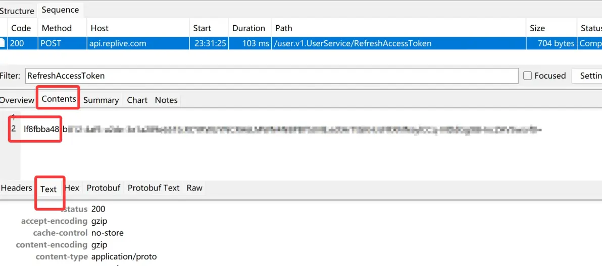

> **请勿泄露账号的 `refresh_token`，非常危险。**

### 3.2 配置信息

用记事本打开下载文件中的 `config.yaml`，填入获取的 refresh token，并按实际情况配置：

```yaml
proxy:
  host: "127.0.0.1"
  port: 7890 # 按实际代理端口修改
refresh_token: "" # 填入获取的 refresh token
ffmpeg_path: "" # 填 ffmpeg 路径，例如 C:/ffmpeg/bin/ffmpeg.exe；已配置环境变量则留空
media_path_win: "" # 图片存储路径，留空则使用当前路径
media_path_linux: ""
email: # 仅在需要邮件功能时配置发送邮箱、SMTP 服务器、授权码和接收邮箱
  smtp_host: "smtp.qq.com"
  sender: "xxxx@qq.com"
  auth_code: ""
  receiver: "xxx@163.com"
```

不需要录制直播时，无需填写 ffmpeg。

### 3.3 使用与数据保留

1. 建议单独创建一个文件夹运行程序。
2. 使用后会生成 `sqlite.db` 文件，请勿删除。
3. 每次打开会生成类似 `replive_202511162148.log` 的日志文件，旧日志可自行清理。
4. 如果只需要下载最新图片，打开 exe 后等待几十秒即可关闭窗口，再到 `media` 文件夹查找下载的图片和视频。
5. 如果需要录制直播，在开播前几分钟打开程序，保持运行，直播结束后再关闭窗口。
